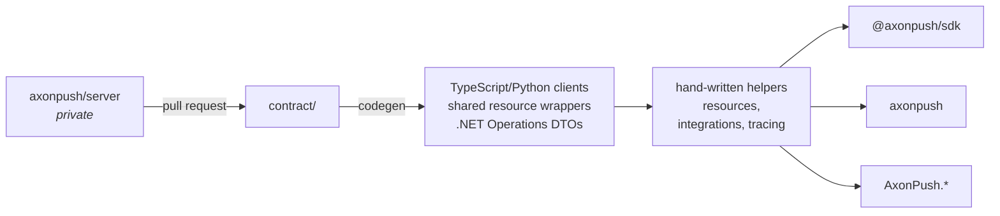

# axonpush SDKs

Every public axonpush client, generated from one contract.

## Start with a workflow

| How you want to work | Install | First step |
|---|---|---|
| YAML or a Node/Bun worker | `npm install @axonpush/sdk@0.0.13` | Run `npx axonpush workflow init --file workflow.yaml`. Import `WorkflowRuntime` from `@axonpush/sdk/workflow` for customer-side actions. |
| Zod 4 or Effect Schema 4 | Add `zod@4` or `effect@^4.1.5` to that project | Follow the [Zod booking example](packages/typescript/examples/workflow-zod.ts) or [Effect booking example](packages/typescript/examples/workflow-effect.ts). Both use the same verifier as YAML. |
| Python | `python -m pip install axonpush==0.0.20` | Run `axonpush workflow init --file workflow.yaml`. Import `axonpush.workflow.run` for local tooling or `WorkflowWorker` from `axonpush.workflow_worker` for action handling. |
| .NET | `dotnet add package AxonPush --version 0.0.7` | Use [AxonPushClient.Workflows](packages/dotnet/README.md#workflow-deployments) for hosted operations. |

Try the [booking walkthrough](https://docs.axonpush.xyz/workflows-quickstart) to
generate hooks, run fixtures, and deploy to a specific workspace and environment.

| package | registry | source |
|---|---|---|
| [`@axonpush/sdk`](https://www.npmjs.com/package/@axonpush/sdk) | npm | [`packages/typescript`](packages/typescript) |
| [`axonpush`](https://pypi.org/project/axonpush/) | PyPI | [`packages/python`](packages/python) |
| `AxonPush`, `AxonPush.Otel`, `AxonPush.SemanticKernel` | NuGet | [`packages/dotnet`](packages/dotnet) |

See [Business operations](AGENT_OPERATIONS.md) for the shared workspace,
template, observation and activity contract. Model routing and business decisions
remain in the source application; the SDK observes their metadata.

## How this fits together



`contract/` is generated by the server and arrives here as a pull request. Do
not hand-edit it. The generated client layers and .NET `Operations/*.g.cs` DTOs
are likewise off limits; change the server, let the contract follow, and let
codegen do the rest.

[Caller operation discovery](docs/operation-capabilities.md) provides advisory permissions for the authenticated caller without changing the SDK method surface.

`tools/generate-operations.py` generates business operation wrappers and invokes
`tools/generate-resource-facades.py` for the Python and TypeScript resource facades.
What you write by hand is the layer on top: framework integrations, resource
helpers and the error tree. Those are what make the SDK pleasant
rather than merely correct.

## Getting started

```
mise install     # bun, node, python, uv, dotnet
mise run install
mise run check   # lint, typecheck, test, parity
```

`mise run codegen` regenerates every client from `contract/`. It needs no
running backend.

## Keeping the SDKs honest

Python and TypeScript resource surfaces are mirrored; shared business operations
also cover .NET. The following checks keep them aligned:

- **`tools/surface-diff.ts`** compares the resource surfaces across languages,
  normalising for naming convention.
- **`tools/check-versions.ts`** asserts each package states one consistent version.
- **`tools/check-contract.ts`** verifies the mirrored contract digest and operation
  list, and that all business operations have resource wrappers in all languages.
  `packages/typescript/tools/check-resource-contract.ts` also checks each facade’s
  body/query/path aliases against its generated operation.
- **`contract/fixtures/`** pins the parts of the contract OpenAPI cannot carry:
  the webhook HMAC scheme, header names (including `X-API-Key` for `ak_` keys
  and `X-Public-Token` for `pt_` public ingest tokens), and the `AXONPUSH_*`
  surface with units. Each SDK replays them as conformance tests.
- **`codegen-clean`** fails CI if a checked-in client no longer matches the
  contract.

## Releasing

Tags are namespaced per package, because `v0.0.6` means three different things
across these histories:

```
sdk-ts-v0.0.8       ->  npm
sdk-py-v0.0.15      ->  PyPI
sdk-dotnet-v0.1.0   ->  NuGet
```

All three publish through trusted publishing: the workflow's OIDC identity is
exchanged for a credential that expires in minutes, so there is no registry
token stored anywhere and nothing to rotate. npm attaches provenance
automatically as a result.

Each publish workflow refuses to run if the tag disagrees with the version in
the package manifest. Versions are independent: the Python SDK moving is no
reason for the .NET one to.

Changelogs are hand-written, one per package.

The npm and PyPI release workflows build the same compiler snapshot for Linux,
macOS and Windows (amd64 and arm64). To reproduce the native package checks,
run `python tools/workflow-compiler/bundle.py python typescript` with Python 3.12+
and Go, then `uv build` in `packages/python` and `bun run build` followed by
`npm pack` in `packages/typescript`. Run
`python tools/workflow-compiler/test-package.py PATH_TO_WHEEL_OR_TARBALL` for each
artifact. This installs it in a fresh project and uses its bundled executable.
`bundle.py` records the upstream commit and checksum for the Apache-licensed
compiler snapshot. Update the snapshot from the matching server revision.

## History

This repo is the merge of `axonpush/ts-sdk`, `axonpush/python-sdk` and
`axonpush/dotnet-sdk`, imported with `git filter-repo` so per-file history
survives. `git log packages/typescript/src/client.ts` reaches back to the
original first commit. The old repos are archived, and their original tags stay
resolvable there as the provenance for anything already published.

### Session evidence

The `telemetry` resource exposes chronological metadata, audited content, and
subject erasure through the same per-client transport:

```typescript
const page = await client.telemetry.timeline(sessionId, { limit: 100 });
const event = await client.telemetry.content(eventId);
await client.telemetry.erase("user", userId, { appId });
```

Python provides `client.telemetry.timeline(session_id, params={"limit": 100})`,
`content(event_id)`, and `erase("user", user_id, params={"app_id": app_id})` on both
sync and async clients. .NET exposes `client.Telemetry.TimelineAsync`,
`ContentAsync`, and `EraseAsync`.

Timeline reads need `observe:read`; content needs `content:read` and recordings
also need `replay:read`. Erasure needs `content:erase`. The server enforces tenant,
app, environment and activity access grants. Follow `hasMore`/`nextOffset` instead
of fetching all content eagerly. A missing/unavailable payload is an explicit
state, not an empty successful interaction. These methods require the matching
server telemetry migration and API deployment.

### Bounded evidence reads

Trace reads return at most 500 spans per page. TypeScript accepts
`client.traces.get(traceId, { limit: 100, cursor: previous.nextCursor })`;
Python accepts `client.traces.get(trace_id, limit=100, cursor=previous.next_cursor)`.
Follow the returned cursor only when `hasMore` / `has_more` is true. The SDKs do
not automatically fetch all pages.

Session timeline calls accept `cursor` and `replayOnly` (`replay_only` in Python).
Use `replayOnly: true` to query recording chunks without walking ordinary session
events. Do not combine a cursor with an offset. Content still requires explicit,
audited reads. See each package changelog for release availability.

### Audit platform feature release

The matching audit-platform server contract adds generated `audit` and
`auditProduct` resources (Python: `audit`, `audit_product`; .NET: `Audit`,
`AuditProduct`). They reuse the client's authenticated transport and preserve
server response/pagination envelopes. Management operations fail closed even
when passive observation is configured fail-open. Use appropriate audit/request
scopes and discover operation availability; passive ingest credentials do not
receive management privileges by default.

```ts
const segments = await client.audit.segments({ limit: 20 });
const agents = await client.auditProduct.agentsList({ limit: 20 });
```

Declared tasks propagate through in-process background and durable publisher
handoffs without leaking a worker creator's task into unrelated later events.
Framework root capture is opt-in with an actual goal; see the integration docs
for native root hooks and explicit runner scopes where hooks cannot report a
whole run's outcome. Reported human actors remain customer assertions.

The public MIT-licensed [v1 evidence specification](spec/evidence/v1/README.md)
defines the event vocabulary, manifest schema and cryptographic format. Offline
verification requires an independently trusted checkpoint or issuer key. This
feature branch is not a claim that an older published SDK exposes these APIs.

## Customer identity and request context

Identify profiles separately from request attribution. Use TypeScript `withContext`, Python `with_context`, or .NET `BeginContext` after authentication to link customer subjects to observations, diagnostic events and workflow cases. Capture context before queued jobs and restore it in the worker. Generated workflow publishing helpers accept the same scope; the deterministic verifier is unchanged.

See the [customer attribution guide](https://docs.axonpush.xyz/customer-attribution) for sync/async examples, explicit business reference mappings, OpenTelemetry integration, background work and local validation.
